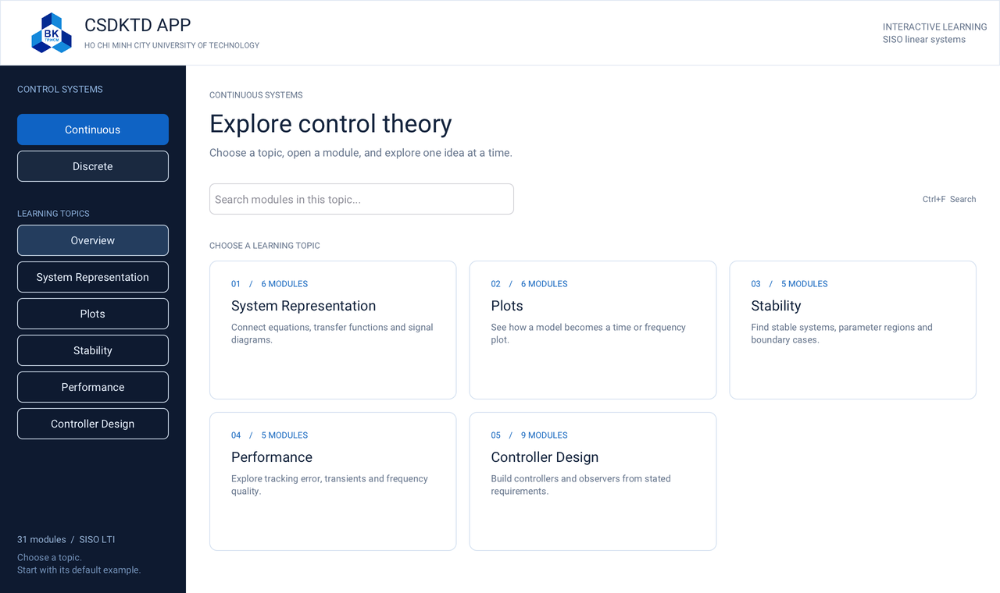
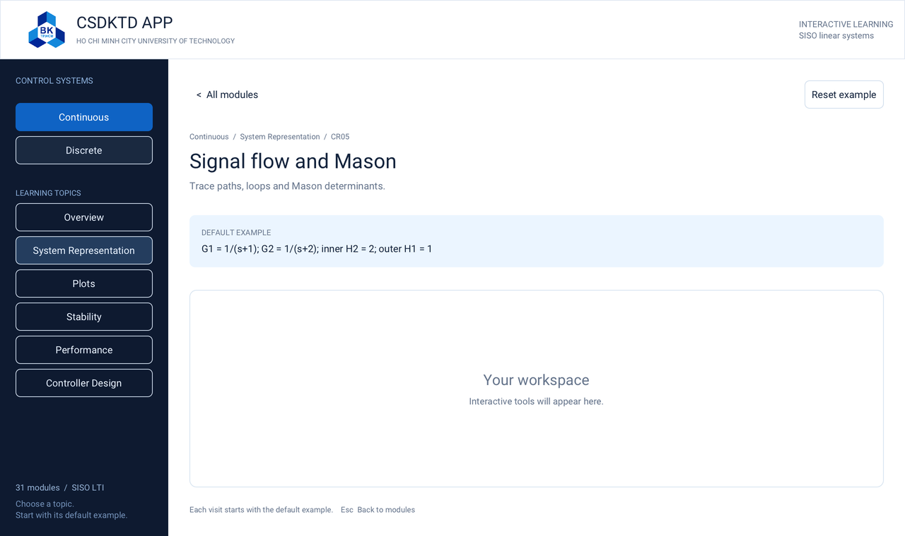

# CSDKTD APP

A native **C11 / Raven** desktop shell for learning **SISO LTI control theory**.

The first implementation provides the global interface and independent subapplication containers. Mathematical tools will be implemented inside those containers later.

## What works now

- An HCMUT-branded entry interface with Continuous and Discrete sections.
- Five topic groups in each section: System Representation, Plots, Stability, Performance and Controller Design.
- A responsive card grid, topic filtering and module search.
- All **56 module routes**, each opening its own page inside the **same native window**.
- A baseline-example description, an empty content container, Back navigation and Reset example.
- Fresh module state on each visit. No lesson saving, persistence, project files or export workflow.

Each subapplication has its own C static-library target and private lifecycle. Shared stateless mathematical/visual helpers can be added later without introducing a shared mutable exercise model. The module structure improves ownership and change boundaries; linked C libraries still share one process and do not provide crash isolation.

The logo comes from the existing instructor course assets. It is embedded so the executable does not depend on the original OneDrive path. See [asset provenance](assets/README.md).





## Build and run on Windows

Use Visual Studio 2022 with **Desktop development with C++**, CMake **3.24 or later**, and Git. Run from a Developer PowerShell at the repository root:

```powershell
cmake -S . -B build/windows -G "Visual Studio 17 2022" -A x64
cmake --build build/windows --config Release --parallel
ctest --test-dir build/windows -C Release --output-on-failure
cmake --install build/windows --config Release --prefix out/windows
& ".\out\windows\bin\CSDKTD APP.exe"
```

The build executable is `build/windows/Release/CSDKTD APP.exe`. Installation puts it in `out/windows/bin` and includes upstream notices. The normal GUI currently requires a working **Vulkan driver**. The Vulkan SDK is not a student runtime requirement; initial source configuration may fetch Raven and Vulkan headers.

The shell has been built and tested locally on Windows x64. Linux, macOS, Windows 7/8/8.1 and the complete requested Windows release matrix remain unverified. See [development/build instructions](docs/DEVELOPMENT.md) and [platform feasibility](docs/PLATFORM_FEASIBILITY.md) before making compatibility claims. Generated binaries and build folders are not committed.

## Develop a subapplication

Start with [modules/README.md](modules/README.md), the [module contract](include/csdktd/module.h), and one directory such as `modules/cr05`. Implement its controls under the shell-provided container, keep state in `host->state`, and release resources on unmount. The shell owns the outer window and navigation.

The shell currently links no numerical or symbolic library. [Mathematical backend options](docs/MATH_BACKEND_OPTIONS.md) compares C-callable numerical, control and exact-algebra candidates for later modules.

## Course plan and evidence

- [Functional specification](docs/FUNCTIONAL_SPECIFICATION.md): accepted subject hierarchy and independent-module architecture.
- [Exercise tool atlas](docs/EXERCISE_TOOL_ATLAS.md): the mathematical tasks and checks to implement in each module.
- [Feature status](docs/FEATURE_REVIEW.md): all 56 concepts accepted, mathematical implementation pending.
- [Continuous](docs/research/CONTINUOUS_EXERCISE_AUDIT.md) and [Discrete](docs/research/DISCRETE_EXERCISE_AUDIT.md) exercise audits, [external exercises](docs/research/EXTERNAL_EXERCISE_REFERENCES.md), and [slide inventory](docs/research/SLIDE_INVENTORY.json).

The course decks/textbooks remain outside this repository. No application-wide software license has been selected. Raven and other supplied assets retain their own notices; see [third-party notices](THIRD_PARTY_NOTICES.md).
