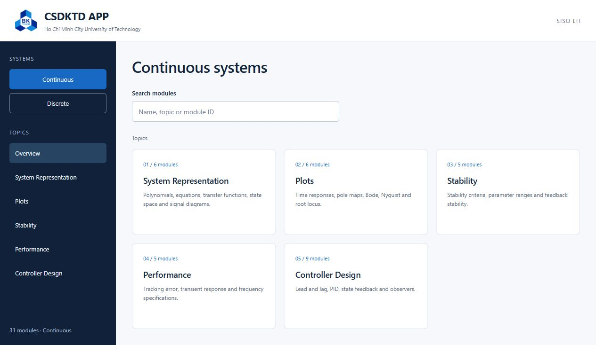
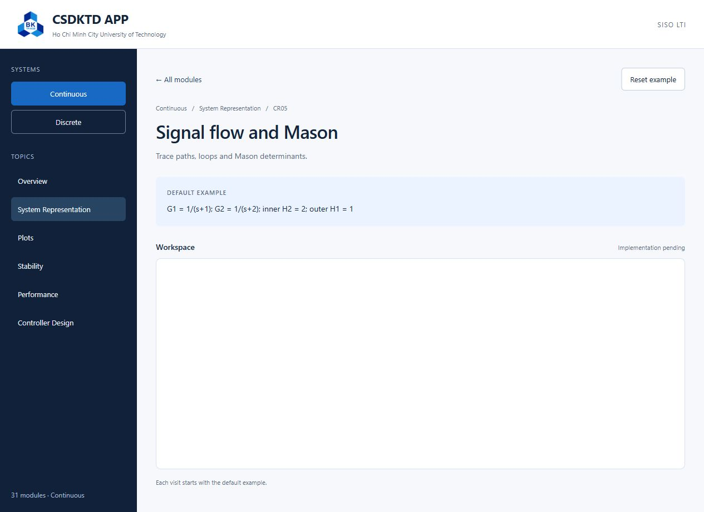
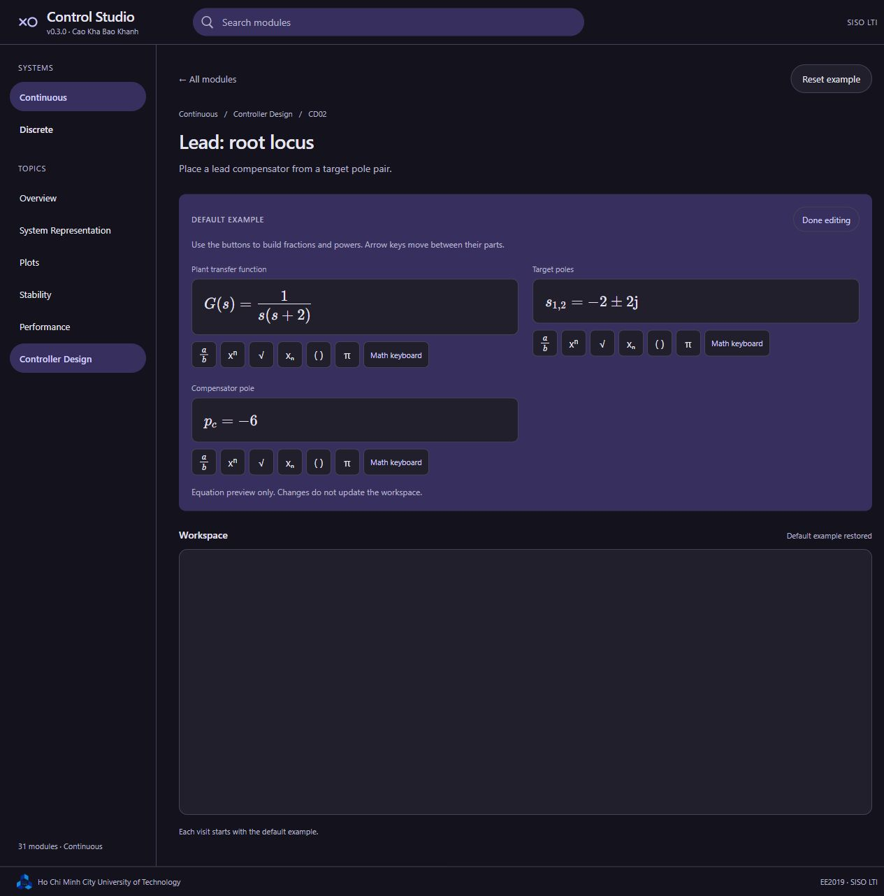

# Control Studio

Control Studio is a browser application for learning **SISO LTI control theory**, organized into Continuous and Discrete systems and five subject groups in each: System Representation, Plots, Stability, Performance and Controller Design. The repository remains `CSDKTD_APP`; package and Cloudflare identifiers remain `csdktd-app`.

**Starting agents? Copy the same [generic `/goal`](docs/WORKER_GOAL.txt) into each local chat.** It contains the exact Git checkout path; agents choose and reserve their own unfinished modules, work in separate checkouts and submit individual branches. Follow [AUTONOMOUS_WORKERS.md](docs/AUTONOMOUS_WORKERS.md) for the claim queue, budgets, checkpoints and integration. No module ID needs editing.

[START_HERE.md](docs/START_HERE.md) explains the product goal, current-work assessment and completion criteria. [Project status](docs/PROJECT_STATUS.md) separates working foundations from module progress; each module owns a `STATUS.md` with its evidence and remaining work.

## Current milestone

At the **v0.3.0 assessment on 29 October 2026**, the application provided a responsive catalogue and **56 independent module scaffolds**. A module opened inside the same browser page, with its title, typeset baseline equations and an empty workspace ready for implementation. **Edit equations** provides visual fraction/power entry and a math keyboard; these preview edits do not update the workspace. This milestone did not deliver 56 mathematical solvers. Check the [module progress records](docs/AGENT_TASKS.md) for work completed after the assessment.

Each module owns its temporary state. Opening or resetting a module starts from its default example; leaving releases its resources. There are no accounts, saved projects, persistence or student export workflows. The first browser release has no service worker or guaranteed offline mode.

The primary interface uses **TypeScript, HTML and CSS with Vite**, without a UI framework. Calculations will run in the student's browser. No application API server, database or API keys are needed. C/WebAssembly remains an optional future mathematical backend, subject to validation.





[Narrow-screen preview](docs/images/web-mobile.jpg)



[Narrow-screen equation editor](docs/images/web-equations-mobile.jpg)

The selected identity uses an Indigo + slate palette, a compact pole/zero mark and a 64 px header. The header shows the application name with `v<package.version> · Cao Kha Bao Khanh` beneath it, reading the version automatically from `package.json`. Catalogue search lives in the header; HCMUT/EE2019 credit lives in the footer. See the [design contract](docs/DESIGN.md) and [asset provenance](docs/ASSETS.md).

## Run locally

Install **Node.js 24 LTS, version 24.15 or later**, with its bundled npm, then run from the repository root. Node 22.22.2+ is also supported by the pinned toolchain:

```sh
npm ci
npm run dev
```

Open the local address printed by Vite. For a production build and local inspection:

```sh
npm run check
npm test
npm run build
npm run preview
```

The static output is `dist/`. The repository includes Cloudflare Workers Static Assets configuration in `wrangler.jsonc`; deployment serves these generated files without an application API server. See [deployment instructions](docs/DEPLOYMENT.md) for the exact publishing workflow and hosting limits. Local preview does not publish anything.

## Implement a teaching tool

Each tool has its own directory under `src/modules/<id>/` and a durable `TASK.md` containing its exercise, source evidence, default example, visual behavior, mathematical checks and copyable agent assignment. The metadata entry is loaded eagerly; its workspace code loads only when opened.

Start with the [agent entry guide](docs/START_HERE.md), then the [56-task index](docs/AGENT_TASKS.md), [contribution guide](docs/CONTRIBUTING.md) and [development guide](docs/DEVELOPMENT.md). Agents should work on one explicitly assigned module at a time. Shared mathematical helpers and dependency changes need coordinated ownership.

Use the [shared equation input and display](docs/EQUATION_INPUT.md) when building a module's actual inputs and results. It bundles MathLive 0.111.1 and its math fonts locally, so students can enter textbook-style mathematics without learning MATLAB or LaTeX syntax. Each module must still validate its supported mathematical forms before computing; the visual editor is not a CAS.

## Course plan and evidence

- [Functional specification](docs/FUNCTIONAL_SPECIFICATION.md): accepted course scope and browser architecture.
- [Exercise tool atlas](docs/EXERCISE_TOOL_ATLAS.md): all 56 mathematical teaching contracts.
- [Feature review](docs/FEATURE_REVIEW.md): accepted scope and the dated scaffold assessment.
- [Mathematical backend options](docs/MATH_BACKEND_OPTIONS.md): numerical, exact-algebra and optional C/WebAssembly considerations.
- [Continuous](docs/research/CONTINUOUS_EXERCISE_AUDIT.md) and [Discrete](docs/research/DISCRETE_EXERCISE_AUDIT.md) audits, [external exercises](docs/research/EXTERNAL_EXERCISE_REFERENCES.md), and [slide inventory](docs/research/SLIDE_INVENTORY.json).

The original course slides, worksheets and textbooks remain outside Git. Existing course and university assets retain their provenance. The earlier native C/Raven experiment is historical context; see the [native platform study](docs/history/PLATFORM_FEASIBILITY_NATIVE.md) and [third-party notices](THIRD_PARTY_NOTICES.md). No application-wide software license has been selected.

The [cleanup record](docs/CLEANUP.md) identifies the native files removed from the active checkout, the recoverable local archive and the research retained for future contributors.
